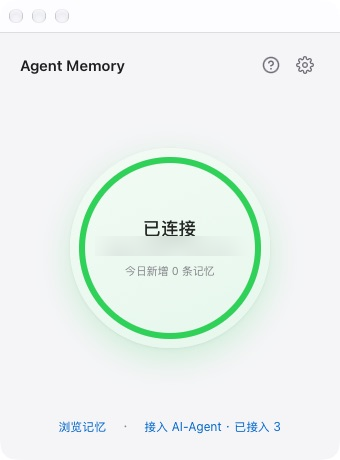

# Agent Memory Client

[English](#english) | 中文

[agentmemory](https://github.com/rohitg00/agentmemory) 服务器的极简桌面客户端：自动建立并维护 SSH 隧道，常驻系统栏显示连接状态，一键把本机的 AI-Agent 接入你的私有记忆库。



## 功能

- **VPN 式主界面**：大状态环 + 一个连接/断开按钮，状态一目了然；服务器、Token 等全部收在设置页
- **常驻系统栏**：macOS 菜单栏 / Windows 任务栏，绿点 = 已连接，红点 = 断开（自动重试），灰点 = 连接中
- **自动隧道**：启动后自动拉起 `ssh -N`，断线按 1s→2s→…→60s 指数退避自动重连
- **手动断开**：点按钮断开即停，不会偷偷重连；「启动时自动连接」开关控制开机行为
- **自动探活**：每 3 秒带 Bearer token 探测 REST 端口，401 会明确提示 Token 无效
- **AI-Agent 接入**：扫描本机已安装的 AI-Agent，逐个点击安装 MCP + SKILL；列表实时显示「已接入」状态
- **今日统计**：主页显示今日新增记忆数与已接入客户端数
- **一键查看器**：托盘菜单或主界面链接直接打开 `http://localhost:3113` 记忆查看器
- **登录自启**：设置里开关，托盘菜单也可切换

## 安装

- **macOS**（Apple Silicon）：双击 `Agent Memory_x.x.x_aarch64.dmg`，把 App 拖进 Applications
- **Windows**：双击 `Agent Memory_x.x.x_x64-setup.exe` 安装（需要 Windows 10+，自带 OpenSSH 客户端）

## 首次配置

首次打开会自动弹出设置窗口：

| 配置项 | 说明 | 默认值 |
|---|---|---|
| 服务器地址 | SSH HostName | 你自己的服务器 |
| SSH 端口 / 用户 | 登录服务器的凭据 | 22 / root |
| SSH 私钥路径 | 留空则使用默认密钥（ssh-agent / ~/.ssh/id_*） | 空 |
| REST / Viewer 端口 | 本地转发端口，对应服务器 3111 / 3113 | 3111 / 3113 |
| Bearer Token | 服务器上 `cat ~/.agentmemory/secret` 获取 | 必填 |

保存后隧道自动建立，托盘变绿即完成。

## 开发

```bash
npm install
npm run tauri dev      # 开发模式（热更新前端）
npm run tauri build    # 产出 macOS .dmg
```

Windows 安装包：推 tag `v*` 到 GitHub，Actions 自动产出（见 `.github/workflows/build.yml`）。

## 架构

- `src-tauri/src/config.rs` — 配置读写（系统配置目录下的 `config.json`，0600 权限，含 Bearer token）
- `src-tauri/src/tunnel.rs` — `ssh -N` 子进程生命周期 + 指数退避重连
- `src-tauri/src/health.rs` — REST 端口定时探活 + 状态事件
- `src-tauri/src/stats.rs` — 今日新增记忆数 / 已接入客户端数统计
- `src-tauri/src/agents.rs` — 本机 AI-Agent 扫描（PATH / App / 扩展）+ MCP 配置注入 + 接入痕迹检测
- `src-tauri/src/tray.rs` — 托盘图标/菜单/自启
- `src-tauri/src/state.rs` — 状态机：`notConfigured → connecting → online / offline`

依赖系统 OpenSSH 客户端（macOS/Linux 自带，Windows 10+ 自带）。

## 注意事项

- 关闭窗口不会退出应用，它在系统栏继续跑；退出请用托盘菜单「退出」
- 私钥建议使用无密码密钥，或先 `ssh-add` 进 ssh-agent（客户端以 `BatchMode` 运行，不会弹出密码输入）

---

<a id="english"></a>

# Agent Memory Client (English)

A minimal desktop client for a self-hosted [agentmemory](https://github.com/rohitg00/agentmemory) server: it keeps an SSH tunnel alive, lives in the system tray/menu bar with live connection status, and wires your local AI-Agents into your private memory store with one click.


## Features

- **VPN-style home**: one big status ring + one connect/disconnect button; server and token live in Settings
- **Tray resident**: green = connected, red = down (auto-retry), gray = connecting
- **Auto tunnel**: launches `ssh -N` on start, reconnects with 1s→2s→…→60s exponential backoff
- **Manual disconnect stays off**: no sneaky reconnects; "auto-connect on launch" toggle controls boot behavior
- **Health probe**: Bearer-token probe of the REST port every 3s; 401 is reported as an invalid token
- **AI-Agent wiring**: scans installed AI-Agents, installs MCP + SKILL per client on click, and shows a persistent "wired" state
- **Daily stats**: today's new memories and wired-client count on the home screen
- **One-click viewer**: opens the memory viewer at `http://localhost:3113`
- **Launch at login**: toggle in Settings or from the tray menu

## Install

- **macOS** (Apple Silicon): open the `.dmg`, drag the app into Applications
- **Windows**: run the `x64-setup.exe` installer (Windows 10+, ships with an OpenSSH client)

## First-run setup

| Field | Description | Default |
|---|---|---|
| Server address | SSH HostName | your own server |
| SSH port / user | Server credentials | 22 / root |
| SSH private key | Empty = default keys (ssh-agent / ~/.ssh/id_*) | empty |
| REST / Viewer ports | Local forwarded ports for server 3111 / 3113 | 3111 / 3113 |
| Bearer token | Get it on the server: `cat ~/.agentmemory/secret` | required |

Save, and the tunnel comes up automatically — the tray icon turns green when done.

## Development

```bash
npm install
npm run tauri dev      # dev mode with hot reload
npm run tauri build    # produces the macOS .dmg
```

Windows installer: push a `v*` tag; GitHub Actions builds it (see `.github/workflows/build.yml`).

## Notes

- Closing the window does not quit the app — it keeps running in the tray. Use the tray menu's Quit.
- Use a passphrase-less key, or `ssh-add` it first (the client runs SSH in `BatchMode` and cannot prompt).
